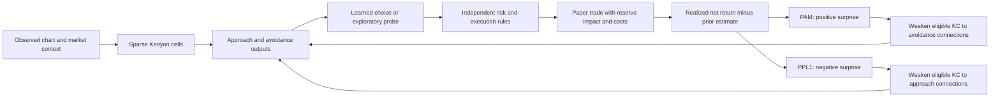

# Opponent reward training

Select **Continuous → Active exploration**, then **Start trading & learning**.
The complete MaleCNS model is required; the old 439-cell selection has no Kenyon
cells. All 166,700 retained neurons continue to compute. The older conservative
profile and its learning checkpoints are preserved.

## Decisions and learning

The initial probe can be queued after six fresh observations when liquidity,
token controls, activity and account limits permit. It fills on the next quote.
Probes use 1% of cash; learned entries use at most 3%, reduced to 1% on warnings
or incomplete checks. Both are capped at 1% of real SOL reserves. Random probes
use the selected exploration probability, reduced for familiar states. An initial
probe and a probe after three eligible minutes prevent indefinite waiting for an
untrained forecast. A 20-second minimum pause follows a closed trade.

The model chooses among 30, 60 and 180-second holding periods. Early risk, quiet
coin and segment-end exits use the actual fresh quote. Pinned positions can span
recording boundaries. A 10% closed-trade drawdown halts entries; 10% of starting
cash locked in unresolved positions also pauses entries. Portfolio limits are
external to the learned circuit. Stop cancels pending buys and preserves an open
position's last valuation; it does not fabricate an exit.

Ordinary pumps and retracements reduce size instead of automatically rejecting
all entries. A new 20% one-quote collapse or 35% reserve withdrawal triggers a
60-second pause. An old price high does not continually restart that pause.
These heuristics cannot identify every rug pull or guarantee an exit.



The installed annotation/graph combination identifies **4,064 KC, 316 PAM,
16 PPL1 and 97 MBON cells**, with **61,210 recorded KC→MBON connections**.
PPL2 cells are not assigned punishment roles. Roughly 5% of KCs are active at a
time. Sparse random feature projections are engineered market encodings. Separate
KC subsets represent bonding curves, PumpSwap and unavailable regime information.
Flow, volume, order arrival rate and unavailable lifetime history are not invented.

An MBON's assigned approach/avoidance role is based on its relative recorded PAM
and PPL1 input strengths. **This assignment is a modeling assumption, not a
verified biological valence annotation.** Unknown transmitter signs remain
unsigned. The model does not claim biological spike timing or human-like thought.

Positive prediction error causes bounded depression of eligible connections onto
the assigned avoidance outputs; negative error depresses assigned approach
connections. Both updates are gated by recorded DAN→MBON connectivity. A saved
entry representation retains full eligibility until closure. Other recent states
receive at most a quarter-strength trace, decaying with a 60-second time constant.
Connection multipliers stay within 0.25–1 and recover slowly toward baseline
(24-hour time constant during observed time). Novelty reflects KC familiarity.

Action values are estimated from MBON state only; raw price features cannot bypass
the circuit into that estimator. Learned entries require a positive opponent bias,
a positive estimated net return and at least three completed examples for that
holding period. Exploration is explicitly labeled and can occur without that
evidence. The positive teaching gain scales PAM updates, not fictitious profit.
Prediction error may be positive even when a loss is smaller than expected.

**Entry associations are learned. Exit timing and risk rules remain separate and
unlearned.** There is no hindsight “sell at the best price” reward, no realized
profit reward while holding, and no reward for a cancelled order or an unavailable
exit. This version does not implement biologically validated compartment valences,
learned exit compartments, inhibitory signs or calibrated DAN feedback dynamics.

The opponent design is inspired by the experimentally observed combinatorial
valence of MBON outputs, not a replication of those experiments.
[Aso et al., 2014](https://elifesciences.org/articles/04580).

## Execution assumptions

Reward-mode fills integrate a constant-product curve using the actual captured
pricing reserves and check real available tokens/SOL. Hypothetical reserve offsets
carry simulated buys/sells forward to later snapshots. Each new snapshot retains
observed external flow; it assumes other traders do not react to our presence.
Offsets are distinct for each reserve regime. This is an approximate
counterfactual simulator, not an executable contract quote.

The configured per-side cost remains an explicit fee/slippage stress assumption
(default 150 bps), with another **assumed 0.000005 SOL per order** for transaction
cost. Price impact is calculated separately. Pump currently publishes a 1.25%
bonding-curve fee and market-cap-dependent canonical PumpSwap fees. Raydium CLMM
paper fills use verified on-chain active-liquidity virtual reserves, and Token-2022
transfer fees are applied on both sides. Contracts, tick crossings, rounding,
priority fees, failed transactions, routing and MEV can differ from these paper
assumptions. [Pump fee schedule](https://pump.fun/docs/fees),
[curve description](https://pump.fun/docs/bonding-curve),
[Raydium SDK V2](https://github.com/raydium-io/raydium-sdk-V2).

Missing execution reserves block a buy or leave an exit unresolved. The 2%
average-price-impact limit applies to new entries. Marks use the same simulated
liquidation calculation as exits. Per-order fees, impact, regime, execution price,
entry kind and favorable/adverse excursions are retained in the ledger. Old
conservative reports continue to use their original price-proxy fill method.

## Inspect and evaluate

The dashboard's **Check learning** button runs a separate comparison using
completed reserve recordings. It trains fresh copies on the first 60% of distinct
coins (ordered by their first recorded observation), then tests on later unseen
coins. It excludes overlapping files, recordings crossing the time boundary and
later repeats of training coins. The split is chosen without looking at profits.

Three seeds compare the trained fly, output learning with fixed synapses, an
untrained fly, random entries, one-minute momentum and holding cash. The display
shows average net P/L, its range across seeds, assumed costs, trade counts and
learned versus exploratory entries. All policies use the same quotes, costs,
execution model, risk rules and minimum pause after closure. Output-only learning
tests the added effect of KC→MBON plasticity and its opponent gate, beyond learning
the value predictor. That baseline disables the neutral opponent gate so its
learned positive predictions can actually produce entries with fixed synapses.
Exploration remains enabled in the trained policies during frozen testing.

**This checks the training method, not the current saved live brain.** It creates
temporary memories, freezes their learned parameters for testing, and verifies
they stay unchanged. Existing live checkpoints and recorded sessions are never
modified. Seeds reuse the same coins and do not increase the number of independent
market examples. A small check, even if profitable, is not evidence of a reliable
trading edge. Stop cancels the check without replacing a completed report.

Completed checks remain in `reports/learning-check-*.json` and in the dashboard's
saved-check selector. The terminal equivalent is:

```bash
.venv/bin/python -m flytrader.evaluation --out reports/learning-check-new.json
```

The live panel shows approach/avoidance strength, sparse KC usage, PAM/PPL1 states,
prediction error and the number/magnitude of changed connections. Its map sample
includes all identified PAM, PPL1 and MBON cells; the remaining display slots are
sampled. All neurons still compute. Click PAM, PPL1 or Outputs to inspect cells.

* `learning/pump-reward-*.npz`: atomic policy, synapse, familiarity and RNG memory;
  fingerprinted by source, graph, annotation and training settings.
* `reports/trial-*.orders.jsonl`: complete execution ledger.
* `reports/trial-*.decisions.jsonl`: every decision, active KC IDs, opponent values,
  dopamine states, position, risk reasons and reward-update counts.
* `data/trial-*-coin-*.market.jsonl`: each quote with the market/reserve information
  available at that time, for honest subsequent execution replay.

Compare learned opponent memory with an untrained fly, random entries and a simple
one-minute momentum baseline on **later, unseen tokens**:

```bash
.venv/bin/python -m flytrader.reward_eval \
  --train data/TRAIN-coin-1.market.jsonl \
  --test data/LATER-DIFFERENT-TOKEN-coin-1.market.jsonl \
  --seed 19 --out reports/reward-comparison-19.json
```

Repeat `--train` and `--test` for more coins, and repeat the experiment with several
seeds and cost assumptions. The tool rejects shared train/test tokens and time
overlap, freezes memory during testing, checks that its parameters did not change,
and never uses or modifies live learning files. Results include net P/L, marked
drawdown, trade outcomes, turnover, costs, impact and KC utilization. Older CSVs
without contemporaneous reserves cannot support this evaluation. Continuous
learning results and synthetic smoke tests are not out-of-sample evidence of an edge.
